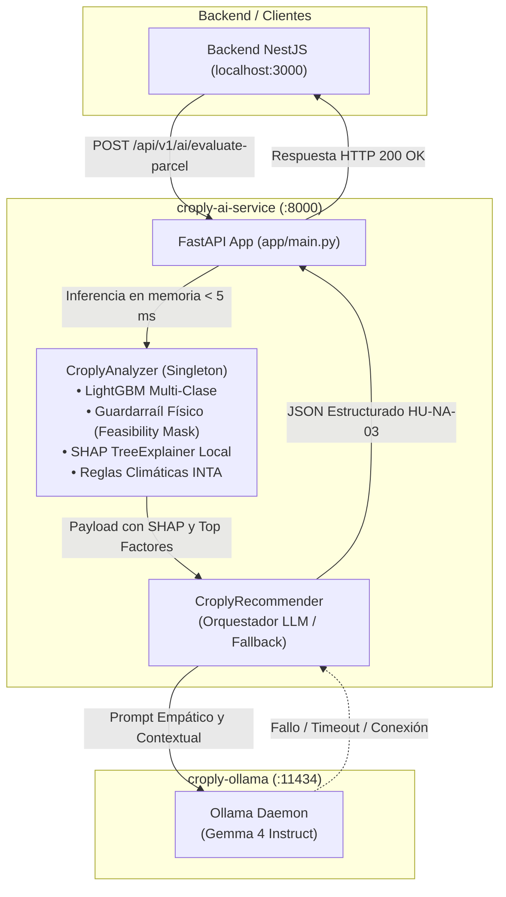

# Croply AI Service (`croply-ai-service`)

> **Microservicio de Inteligencia Artificial para el Diagnóstico Edafoclimático y Recomendaciones Agronómicas en Tiempo Real.**  
> Diseñado para pequeños y medianos productores de la región de Cuyo (Mendoza, Argentina) en el marco de la plataforma **Croply**.

---

## 1. Arquitectura del Microservicio

El servicio implementa una **Arquitectura Híbrida en 2 Fases (Analítica + Generativa)** de alto rendimiento:



### Componentes Principales:
1. **Fase 1 - Motor Analítico Determinista y Predictivo (`app/analyzer.py`):**
   - **LightGBM Classifier v1.3.0 (`app/models/croply_classifier_v1.joblib`):** Inferencia en memoria singleton (< 5 ms). Predice entre 7 acciones agronómicas (`REGAR_URGENTE`, `REGAR_PROGRAMADO`, `SUSPENDER_RIEGO`, `VENTANA_OPTIMA_CURAR`, `POSTERGAR_CURACION_CLIMA`, `CORREGIR_PH_SUELO`, `ESTADO_OPTIMO_SIN_ACCION`).
   - **Guardarraíl Físico (`apply_feasibility_mask`):** Anula probabilidades de acciones imposibles ante fallas de sensores (e.g. sin sensor de humedad de suelo no puede recomendar regar ni suspender riego por humedad).
   - **Explicabilidad Local SHAP:** Deduplicación semántica y filtrado de factores físicos reales con atribución positiva (`shap_attribution > 0`).
   - **Reglas Climáticas INTA Mendoza (`evaluate_climate_alerts`):** Detección determinista de `ALERTA_HELADA`, `ALERTA_GOLPE_CALOR`, `ALERTA_VIENTO_ZONDA` y `ALERTA_TORMENTA`.

2. **Fase 2 - Orquestador y Redactor LLM (`app/recommender.py`):**
   - **Gemma 4 en Ollama:** Redacción en español rioplatense, tono empático, conciso (título <= 40 caracteres, texto breve <= 120 caracteres).
   - **Regla de Estado Vacío (`HU-NA-03`):** Si el lote vegeta en estado óptimo sin alertas, retorna `recomendacion_vigente: null` sin invocar al LLM.
   - **Fallback Determinista:** Si Ollama no responde o supera el timeout, el servicio genera automáticamente una recomendación agronómica basada en pautas INTA, garantizando disponibilidad 100%.

---

## 2. Estructura del Proyecto (Clean Architecture para ML)

```text
croply-ai-service/
├── app/                              # Código productivo del Microservicio FastAPI
│   ├── __init__.py
│   ├── main.py                       # Servidor FastAPI (/health y /evaluate-parcel)
│   ├── analyzer.py                   # Singleton LightGBM + SHAP + Reglas INTA
│   ├── recommender.py                # Cliente asíncrono Ollama + Fallback
│   └── models/
│       └── croply_classifier_v1.joblib # Modelo compilado v1.3.0
├── training/                         # Pipelines de ingestión y reentrenamiento (MLOps)
│   ├── __init__.py
│   ├── build_hybrid_dataset.py       # Generador de dataset físico-sintético
│   ├── fetch_mendoza_weather.py      # Extractor Open-Meteo Guaymallén
│   └── train_baseline.py             # Script de entrenamiento LightGBM + SHAP
├── data/                             # Datos y contexto (excluidos de la imagen Docker)
│   ├── context/                      # Calendario de siembra y reglas agronómicas INTA
│   └── raw_datasets/                 # Datasets CSV y payloads de prueba
├── tests/                            # Suite de pruebas automatizadas
│   ├── __init__.py
│   └── test_service_e2e.py           # 5 Escenarios E2E integrales
├── docs/                             # Documentación e informes técnicos
│   ├── 01_investigacion_datasets_y_umbrales_inta.md
│   ├── 02_diseno_modelo_ml_croply.md
│   └── informes_tecnicos/
├── scripts/                          # Scripts operativos
│   └── ollama-entrypoint.sh          # Auto-pull de gemma4 en contenedor Ollama
├── Dockerfile                        # Imagen de producción en Python 3.13-slim con libgomp1
├── .dockerignore                     # Exclusiones de build context
├── docker-compose.yml                # Orquestador del microservicio + Ollama
├── .env.example                      # Plantilla de variables de entorno
├── requirements.txt                  # Dependencias de producción
├── requirements-dev.txt              # Dependencias de desarrollo y test
└── README.md                         # Documentación de uso e integración NestJS
```

---

## 3. Requisitos Previos e Instalación

### Requisitos:
- **Python 3.11, 3.12 o 3.13** (con `pip` y `venv`).
- **Docker & Docker Compose** (para despliegue en contenedores).
- **Ollama** (opcional para desarrollo local si se usa `http://localhost:11434`).

### Instalación Local:
```bash
# 1. Clonar el repositorio
git clone <URL_REPOSITORIO> croply-ai-service
cd croply-ai-service

# 2. Crear y activar entorno virtual
python -m venv .venv
# En Windows (PowerShell):
.venv\Scripts\Activate.ps1
# En Linux/macOS:
source .venv/bin/activate

# 3. Instalar dependencias de producción y desarrollo
pip install --upgrade pip
pip install -r requirements-dev.txt

# 4. Configurar variables de entorno
cp .env.example .env
```

---

## 4. Modos de Ejecución

### Opción A: Despliegue Completo con Docker Compose (Recomendado)
Inicia el microservicio FastAPI y el contenedor Ollama con auto-descarga del modelo `gemma4`:

```bash
docker compose up --build -d
```

Verificación de logs:
```bash
docker compose logs -f croply-ai-service
docker compose logs -f croply-ollama
```

### Opción B: Ejecución Local en Desarrollo
```bash
# Iniciar servidor FastAPI con recarga en caliente
uvicorn app.main:app --host 0.0.0.0 --port 9000 --reload
```

---

## 5. Referencia de la API REST

### 1. Diagnóstico del Sistema (`GET /api/v1/ai/health`)
Verifica el estado del modelo en memoria, constantes edafológicas y conectividad con Ollama.

**Ejemplo cURL:**
```bash
curl -X GET "http://localhost:9000/api/v1/ai/health" -H "Accept: application/json"
```

**Respuesta de ejemplo (200 OK):**
```json
{
  "status": "healthy",
  "version": "1.3.0-lgbm-loam-prod",
  "model_loaded": true,
  "edaphic_constants": {
    "THETA_CC": 30.0,
    "THETA_PMP": 14.0,
    "AU_TOTAL": 16.0
  },
  "ollama_service": {
    "url": "http://localhost:11434",
    "model": "gemma4",
    "reachable": true
  }
}
```

---

### 2. Evaluación Agronómica de Parcela (`POST /api/v1/ai/evaluate-parcel`)
Recibe la telemetría IoT de la parcela, el pronóstico meteorológico y el historial de manejo, retornando la acción clasificada, explicabilidad SHAP y la recomendación empática.

**Ejemplo cURL (Caso Estrés Hídrico en Tomate):**
```bash
curl -X POST "http://localhost:9000/api/v1/ai/evaluate-parcel" \
  -H "Content-Type: application/json" \
  -d '{
    "parcela_id": "parcela-norte-tomate-01",
    "finca_id": "finca-guaymallen-01",
    "cultivo": "tomate",
    "dias_desde_siembra": 60,
    "etapa_fenologica_idx": 2,
    "telemetria_iot": {
      "temp_ambiente_c": 28.5,
      "humedad_ambiente_pct": 38.0,
      "humedad_suelo_pct": 14.8,
      "radiacion_solar_wm2": 820.0,
      "ph_suelo": 6.4,
      "lluvia_mm_24h": 0.0
    },
    "pronostico_meteo": {
      "temp_min_pronostico": 15.0,
      "temp_max_pronostico": 32.0,
      "precip_pronostico_24h": 0.0,
      "viento_kmh": 12.0,
      "wind_gust_kmh": 16.0,
      "et0_diario": 5.8
    },
    "historial_manejo": {
      "dias_desde_ultimo_riego": 5,
      "dias_desde_ultima_curacion": 12
    }
  }'
```

**Respuesta de ejemplo (200 OK):**
```json
{
  "parcela_id": "parcela-norte-tomate-01",
  "cultivo": "tomate",
  "etapa_fenologica": "media",
  "accion_recomendada": "REGAR_URGENTE",
  "confianza_ml": 1.0,
  "severidad": "Alta",
  "sensor_origen_principal": "humedad_suelo_pct",
  "explicabilidad_top3_factores": [
    {
      "feature": "humedad_suelo_pct",
      "sensor_ui": "humedad_suelo_pct",
      "valor": 14.8,
      "shap_attribution": 4.1923
    },
    {
      "feature": "dias_desde_ultimo_riego",
      "sensor_ui": "dias_desde_ultimo_riego",
      "valor": 5.0,
      "shap_attribution": 1.831
    },
    {
      "feature": "temp_max_pronostico",
      "sensor_ui": "temp_ambiente_c",
      "valor": 32.0,
      "shap_attribution": 0.4512
    }
  ],
  "alertas_climaticas": [],
  "requiere_intervencion_llm": true,
  "recomendacion_vigente": {
    "titulo_corto": "Riego urgente recomendado",
    "texto_breve": "Humedad del suelo (14.8%) bajo umbral crítico en floración.",
    "texto_explicativo_extendido": "El cultivo de Tomate en etapa media presenta un déficit hídrico severo detectado por humedad_suelo_pct (14.8%). Se aconseja activar inmediatamente el turno de riego para prevenir estrés irreversible y pérdida de rendimiento."
  },
  "mensaje_ui": null,
  "fuente_generacion": "fallback_determinista_inta",
  "latencia_analyzer_ms": 4.12,
  "latencia_total_ms": 8.45
}
```

---

## 6. Módulo de Integración para Backend en NestJS (TypeScript)

Para consumir este microservicio desde el Backend de Croply (`http://localhost:3000/api`), implementa el siguiente servicio de integración utilizando `@nestjs/axios` y TypeORM:

### 1. DTOs de Integración (`ai-service.dto.ts`)
```typescript
import { IsString, IsNumber, IsOptional, ValidateNested, Min, Max } from 'class-validator';
import { Type } from 'class-transformer';

export class TelemetriaIotDto {
  @IsOptional() @IsNumber() @Min(-20) @Max(60)
  temp_ambiente_c?: number | null;

  @IsOptional() @IsNumber() @Min(0) @Max(100)
  humedad_ambiente_pct?: number | null;

  @IsOptional() @IsNumber() @Min(0) @Max(100)
  humedad_suelo_pct?: number | null;

  @IsOptional() @IsNumber() @Min(0) @Max(1500)
  radiacion_solar_wm2?: number | null;

  @IsOptional() @IsNumber() @Min(2) @Max(12)
  ph_suelo?: number | null;

  @IsOptional() @IsNumber() @Min(0)
  lluvia_mm_24h?: number;
}

export class PronosticoMeteoDto {
  @IsNumber() temp_min_pronostico: number;
  @IsNumber() temp_max_pronostico: number;
  @IsNumber() @Min(0) precip_pronostico_24h: number;
  @IsNumber() @Min(0) viento_kmh: number;
  @IsOptional() @IsNumber() @Min(0) wind_gust_kmh?: number;
  @IsOptional() @IsNumber() @Min(0) et0_diario?: number;
}

export class HistorialManejoDto {
  @IsNumber() @Min(0) dias_desde_ultimo_riego: number;
  @IsNumber() @Min(0) dias_desde_ultima_curacion: number;
}

export class EvaluateParcelRequestDto {
  @IsString() parcela_id: string;
  @IsOptional() @IsString() finca_id?: string;
  @IsString() cultivo: string;
  @IsNumber() @Min(0) dias_desde_siembra: number;
  @IsNumber() @Min(0) @Max(3) etapa_fenologica_idx: number;

  @ValidateNested() @Type(() => TelemetriaIotDto)
  telemetria_iot: TelemetriaIotDto;

  @ValidateNested() @Type(() => PronosticoMeteoDto)
  pronostico_meteo: PronosticoMeteoDto;

  @ValidateNested() @Type(() => HistorialManejoDto)
  historial_manejo: HistorialManejoDto;
}

export interface RecomendacionVigente {
  titulo_corto: string;
  texto_breve: string;
  texto_explicativo_extendido: string;
}

export interface Top3FactorShap {
  feature: string;
  sensor_ui: string;
  valor: number | null;
  shap_attribution: number;
}

export interface AlertaClimatica {
  codigo_alerta: string;
  severidad: 'Alta' | 'Media' | 'Baja';
  descripcion: string;
}

export interface AiEvaluationResponseDto {
  parcela_id: string;
  cultivo: string;
  etapa_fenologica: string;
  accion_recomendada: string;
  confianza_ml: number;
  severidad: 'Alta' | 'Media' | 'Baja';
  sensor_origen_principal: string;
  explicabilidad_top3_factores: Top3FactorShap[];
  alertas_climaticas: AlertaClimatica[];
  requiere_intervencion_llm: boolean;
  recomendacion_vigente: RecomendacionVigente | null;
  mensaje_ui: string | null;
  fuente_generacion: string;
  latencia_analyzer_ms: number;
  latencia_total_ms: number;
}
```

### 2. Servicio de Integración NestJS (`ai-integration.service.ts`)
```typescript
import { Injectable, Logger, HttpException, HttpStatus } from '@nestjs/common';
import { HttpService } from '@nestjs/axios';
import { ConfigService } from '@nestjs/config';
import { firstValueFrom } from 'rxjs';
import { AxiosError } from 'axios';
import { EvaluateParcelRequestDto, AiEvaluationResponseDto } from './ai-service.dto';

@Injectable()
export class AiIntegrationService {
  private readonly logger = new Logger(AiIntegrationService.name);
  private readonly aiServiceUrl: string;

  constructor(
    private readonly httpService: HttpService,
    private readonly configService: ConfigService,
  ) {
    this.aiServiceUrl = this.configService.get<string>(
      'AI_SERVICE_URL',
      'http://localhost:8000',
    );
  }

  /**
   * Envía la telemetría consolidada de una parcela al microservicio Croply AI.
   */
  async evaluateParcel(dto: EvaluateParcelRequestDto): Promise<AiEvaluationResponseDto> {
    const endpoint = `${this.aiServiceUrl}/api/v1/ai/evaluate-parcel`;
    this.logger.log(`Consultando evaluación agronómica para parcela: ${dto.parcela_id}`);

    try {
      const response = await firstValueFrom(
        this.httpService.post<AiEvaluationResponseDto>(endpoint, dto, {
          timeout: 10000, // Timeout seguro de 10 segundos
          headers: { 'Content-Type': 'application/json' },
        }),
      );
      return response.data;
    } catch (error) {
      const axiosError = error as AxiosError;
      this.logger.error(
        `Error al comunicar con microservicio AI: ${axiosError.message}`,
        axiosError.stack,
      );
      throw new HttpException(
        'El servicio de análisis agronómico no se encuentra disponible.',
        HttpStatus.SERVICE_UNAVAILABLE,
      );
    }
  }

  /**
   * Mapea una entidad Parcela de TypeORM a EvaluateParcelRequestDto y solicita la recomendación.
   */
  async evaluateParcelEntity(parcela: any, meteo: any, historial: any): Promise<AiEvaluationResponseDto> {
    const payload: EvaluateParcelRequestDto = {
      parcela_id: parcela.id.toString(),
      finca_id: parcela.fincaId?.toString() || 'finca-01',
      cultivo: parcela.cultivo.toLowerCase(),
      dias_desde_siembra: parcela.diasDesdeSiembra,
      etapa_fenologica_idx: parcela.etapaFenologicaIdx ?? 1,
      telemetria_iot: {
        temp_ambiente_c: parcela.ultimoRegistroIot?.temperatura ?? null,
        humedad_ambiente_pct: parcela.ultimoRegistroIot?.humedadAmbiente ?? null,
        humedad_suelo_pct: parcela.ultimoRegistroIot?.humedadSuelo ?? null,
        radiacion_solar_wm2: parcela.ultimoRegistroIot?.radiacionSolar ?? null,
        ph_suelo: parcela.ultimoRegistroIot?.phSuelo ?? null,
        lluvia_mm_24h: parcela.ultimoRegistroIot?.lluvia24h ?? 0.0,
      },
      pronostico_meteo: {
        temp_min_pronostico: meteo.tempMin,
        temp_max_pronostico: meteo.tempMax,
        precip_pronostico_24h: meteo.precipitacion24h,
        viento_kmh: meteo.vientoKmh,
        wind_gust_kmh: meteo.vientoRafagasKmh,
        et0_diario: meteo.et0 ?? 5.0,
      },
      historial_manejo: {
        dias_desde_ultimo_riego: historial.diasUltimoRiego,
        dias_desde_ultima_curacion: historial.diasUltimaCuracion,
      },
    };

    return this.evaluateParcel(payload);
  }
}
```

---

## 7. Ejecución de Pruebas Automatizadas

El proyecto incluye una suite completa de pruebas de integración E2E que valida los flujos críticos de la historia de usuario `HU-NA-03`:

```bash
# Ejecutar la suite completa
python tests/test_service_e2e.py
```

### Casos Validados en la Suite:
- **Test 1:** Diagnóstico de salud (`GET /api/v1/ai/health`).
- **Test 2 (Flujo A):** Déficit hídrico severo en Tomate -> Clasificación `REGAR_URGENTE`, latencia < 60 ms y fallback determinista.
- **Test 3 (Flujo B):** Sensores faltantes totales (`temp`, `humedad` y `suelo` en `null`) + viento 26 km/h -> Guardarraíl anula riego y predice `POSTERGAR_CURACION_CLIMA` con sensor `viento_kmh`.
- **Test 4 (Flujo C):** Parcela en condición óptima -> Predice `ESTADO_OPTIMO_SIN_ACCION`, `requiere_intervencion_llm: false` y `recomendacion_vigente: null`.
- **Test 5 (Flujo D):** Alerta climática de helada (-2°C) en estado óptimo -> Predice `ESTADO_OPTIMO_SIN_ACCION` con `requiere_intervencion_llm: true` y recomendación de precaución.

---

## 8. Estrategia de Ramas Git (Git Flow MLOps)

El repositorio sigue un modelo estricto de bifurcación:
- **`main`**: Rama protegida de producción. Contiene código estable, versiones etiquetadas (`v1.3.0`) y artefactos listos para despliegue.
- **`develop`**: Rama base para integración continua de features agronómicas, mejoras al prompt de Ollama y nuevos modelos.
- **`feature/*`**: Ramas de corta duración derivadas de `develop` para nuevas capacidades o ajustes de umbrales.
- **`hotfix/*`**: Correcciones urgentes aplicadas directamente sobre `main` y sincronizadas hacia `develop`.
