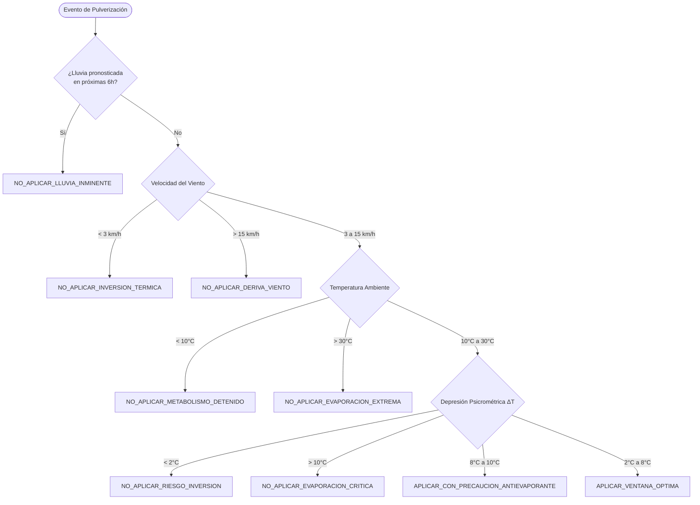

# Fase 1: Investigación de Fuentes de Datos Climáticos, Datasets IoT y Umbrales Agronómicos (INTA - FAO) para la Región de Cuyo

**Proyecto:** Croply — Plataforma Inteligente de Soporte a Decisiones Agronómicas  
**Área Geográfica:** Región de Cuyo (Mendoza y San Juan, República Argentina)  
**Autor:** Equipo de Investigación de Machine Learning y Agronomía Croply  
**Fecha de Publicación:** Octubre de 2026  
**Estado:** Documento Técnico Consolidado — Fase 1  

---

## Resumen Ejecutivo

El presente documento consolida la investigación técnica de la Fase 1 del proyecto **Croply**, cuyo objetivo es fundamentar la arquitectura de datos y los modelos de toma de decisión inteligente (Machine Learning y sistemas expertos agronómicos) para los seis cultivos hortícolas prioritarios de la provincia de Mendoza: **Tomate**, **Ajo**, **Lechuga**, **Cebolla**, **Pimiento** y **Papa**.

Se abordan de manera exhaustiva cuatro pilares técnicos:
1. **Fuentes de datos meteorológicos históricos y de reanálisis:** Evaluación exhaustiva de la API de archivo de Open-Meteo (ERA5-Land a 9 km de resolución) y de la API NASA POWER (comunidad AG), detallando parámetros de consulta, variables agroclimáticas, límites de cuota y URLs de parametrización para cuatro enclaves hortícolas clave de Mendoza.
2. **Evaluación de datasets públicos de sensores IoT agrícolas:** Análisis comparativo de repositorios internacionales (Kaggle, Zenodo, Mendeley Data, UCI ML Repository), justificación del descarte del paradigma estático "Crop Recommendation (N-P-K)" y fundamentación metodológica para la generación de un **Dataset Híbrido** específico para Cuyo.
3. **Parámetros fisiológicos y umbrales agronómicos validados (INTA y FAO-56):** Modelado edafoclimático para suelos Francos y Franco Arenosos característicos de los oasis de regadío mendocinos, con fichas detalladas de fenología, coeficientes de cultivo ($Kc$), agotamiento permisible ($p$), humedad volumétrica crítica ($\theta_{crit}$), límites térmicos, salinidad y radiación solar.
4. **Condiciones meteorológicas límite para pulverización fitosanitaria ("Curar"):** Especificación técnica de los rangos operativos de viento, temperatura, humedad relativa, ventanas de lavado por lluvia y cálculo psicrométrico del Delta T ($\Delta T$).
5. **Referencias bibliográficas formales:** Normalización académica de la literatura técnica empleada (INTA, FAO, UNCuyo, CASAFE).

---

## 1. Datos Climáticos Históricos Reales de Mendoza (Cuyo)

La Región de Cuyo se caracteriza por un clima árido a semiárido (clasificación Köppen-Geiger *BWk* / *BSk*), con precipitaciones medias anuales escasas (entre 180 y 250 mm concentradas en el período estival en forma de tormentas convectivas), elevada evapotranspiración potencial ($ET_0 > 1200\text{--}1400\text{ mm/año}$), alta heliofanía relativa, marcadas oscilaciones térmicas día-noche y la ocurrencia episódica del viento Zonda (viento catabático cálido y extremadamente seco con ráfagas superiores a 50 km/h y humedad relativa menor al 10%).

Para entrenar modelos de aprendizaje automático capaces de predecir la evapotranspiración de referencia ($ET_0$), el agotamiento de humedad en el bulbo radicular y la ventana de pulverización, es mandatario disponer de registros meteorológicos continuos, calibrados y georreferenciados en los oasis productivos.

---

### 1.1. Open-Meteo Historical Weather API (Archive API)

La **Open-Meteo Archive API** proporciona acceso programático a datos históricos de reanálisis meteorológico global derivados de **ERA5** y **ERA5-Land**, operados por el Centro Europeo de Previsiones Meteorológicas a Plazo Medio (ECMWF) y el Servicio de Cambio Climático de Copernicus (C3S).

#### Especificaciones Técnicas y Operativas
- **Endpoint Base:** `https://archive-api.open-meteo.com/v1/archive`
- **Modelo de Reanálisis:** ERA5-Land Reanalysis acoplado con ERA5 de alta resolución atmosférica.
- **Resolución Espacial:** Rejilla regular de $0.1^\circ \times 0.1^\circ$ (aproximadamente **9 km de paso de malla**), lo que permite capturar contrastes orográficos entre el llano y el piedemonte andino.
- **Resolución Temporal:** Paso de tiempo horario (1 hora) y agregaciones diarias calculadas a partir del paso horario.
- **Cobertura Temporal:** Desde el 1 de enero de 1940 hasta 2 a 5 días antes del tiempo presente (latencia natural de validación de datos de reanálisis).
- **Políticas de Uso y Rate Limits:**
  - Nivel Gratuito (Non-commercial & Research): Hasta **10.000 llamadas diarias** por IP.
  - Tasa instantánea permitida: Hasta 5.000 llamadas por hora y 600 llamadas por minuto.
  - Sin necesidad obligatoria de clave de API (*API Key*), con soporte nativo de compresión gzip y formato JSON o FlatBuffers binario para alto rendimiento.

#### Parámetros de Consulta de la API

| Parámetro | Tipo | Requerido | Descripción y Valores Admitidos |
| :--- | :--- | :--- | :--- |
| `latitude` | Float | Sí | Latitud del punto geográfico en coordenadas decimales WGS84 (ej. `-32.91`). |
| `longitude` | Float | Sí | Longitud del punto geográfico en coordenadas decimales WGS84 (ej. `-68.72`). |
| `start_date` | String | Sí | Fecha de inicio en formato ISO-8601 `YYYY-MM-DD`. |
| `end_date` | String | Sí | Fecha de finalización en formato ISO-8601 `YYYY-MM-DD`. |
| `hourly` | String list | Opcional | Lista de variables meteorológicas horarias separadas por coma. |
| `daily` | String list | Opcional | Lista de variables meteorológicas diarias agregadas. |
| `timezone` | String | Sí | Zona horaria para el parseo temporal. En Mendoza: `America/Argentina/Mendoza` o `auto`. |
| `temperature_unit` | String | Opcional | `celsius` (predeterminado) o `fahrenheit`. |
| `wind_speed_unit` | String | Opcional | `kmh` (predeterminado), `ms` (m/s), `mph` o `kn` (nudos). |
| `precipitation_unit` | String | Opcional | `mm` (predeterminado) o `inch`. |
| `cell_selection` | String | Opcional | `land` (fuerza celda terrestre más cercana) o `nearest`. |

#### Variables Horarias Esenciales para Croply (`hourly`)
1. `temperature_2m`: Temperatura del aire a 2 metros sobre el suelo (°C).
2. `relative_humidity_2m`: Humedad relativa del aire a 2 metros (%).
3. `dew_point_2m`: Temperatura de punto de rocío a 2 metros (°C), crítica para el cálculo psicrométrico de bulbo húmedo y Delta T.
4. `apparent_temperature`: Sensación térmica (°C) integrando viento y humedad.
5. `precipitation`: Precipitación total líquida acumulada en la hora (mm).
6. `rain`: Lluvia de gran escala (mm).
7. `weather_code`: Código numérico sinóptico WMO (0-99).
8. `pressure_msl`: Presión atmosférica reducida al nivel del mar (hPa).
9. `surface_pressure`: Presión atmosférica real en superficie (hPa).
10. `cloud_cover`: Cobertura nubosa total del cielo (%).
11. `et0_fao_evapotranspiration`: Evapotranspiración de referencia horaria según la ecuación FAO-56 Penman-Monteith (mm).
12. `vapour_pressure_deficit`: Déficit de presión de vapor ($VPD$) en kPa, variable clave de demanda transpiratoria.
13. `wind_speed_10m`: Velocidad del viento a 10 metros de altura (km/h).
14. `wind_direction_10m`: Dirección de procedencia del viento en grados azimutales (0°-360°).
15. `wind_gusts_10m`: Ráfagas máximas de viento a 10 metros en el intervalo horario (km/h).
16. `soil_temperature_0_to_7cm`: Temperatura del suelo en la capa superficial de 0 a 7 cm (°C).
17. `soil_temperature_7_to_28cm`: Temperatura del suelo en el estrato radicular de 7 a 28 cm (°C).
18. `soil_moisture_0_to_7cm`: Contenido volumétrico de agua del suelo ($m^3/m^3$) en superficie.
19. `soil_moisture_7_to_28cm`: Contenido volumétrico de agua del suelo ($m^3/m^3$) en la zona radicular media.
20. `shortwave_radiation_instant`: Radiación solar global de onda corta incidente ($W/m^2$).
21. `direct_normal_irradiance_instant`: Irradiancia solar directa normal ($W/m^2$).
22. `diffuse_radiation_instant`: Irradiancia solar difusa horizontal ($W/m^2$).

#### Variables Diarias Esenciales para Croply (`daily`)
1. `temperature_2m_max` / `temperature_2m_min` / `temperature_2m_mean`: Temperaturas extremas y media diaria (°C).
2. `precipitation_sum`: Precipitación acumulada en 24 horas (mm).
3. `precipitation_hours`: Cantidad de horas con lluvia mensurable ($>0.1\text{ mm}$).
4. `et0_fao_evapotranspiration`: Evapotranspiración diaria acumulada FAO-56 ($mm/\text{día}$).
5. `wind_speed_10m_max` / `wind_gusts_10m_max`: Velocidad máxima y ráfaga pico del día (km/h).
6. `wind_direction_10m_dominant`: Dirección dominante del viento en el día (°).
7. `shortwave_radiation_sum`: Radiación solar global diaria acumulada ($MJ/m^2/\text{día}$).
8. `sunshine_duration`: Duración de la insolación efectiva (segundos).

---

### 1.2. URLs de Extracción Parametrizadas para Enclaves Hortícolas de Mendoza

Se seleccionaron cuatro nodos geográficos representativos de la matriz hortícola de Mendoza:

```bash
# 1. Guaymallén (Cinturón Hortícola Norte - Tomate, Lechuga, Papa, Pimiento)
# Coordenadas: Latitud -32.91, Longitud -68.72
https://archive-api.open-meteo.com/v1/archive?latitude=-32.91&longitude=-68.72&start_date=2021-01-01&end_date=2024-12-31&hourly=temperature_2m,relative_humidity_2m,dew_point_2m,apparent_temperature,precipitation,et0_fao_evapotranspiration,vapour_pressure_deficit,wind_speed_10m,wind_direction_10m,wind_gusts_10m,soil_temperature_0_to_7cm,soil_temperature_7_to_28cm,soil_moisture_0_to_7cm,soil_moisture_7_to_28cm,shortwave_radiation_instant&daily=temperature_2m_max,temperature_2m_min,precipitation_sum,et0_fao_evapotranspiration,wind_speed_10m_max,wind_gusts_10m_max,shortwave_radiation_sum&timezone=America%2FArgentina%2FMendoza

# 2. Luján de Cuyo (Primera Zona Vitivinícola y Hortícola - Ajo, Tomate, Hortalizas de hoja)
# Coordenadas: Latitud -33.03, Longitud -68.88
https://archive-api.open-meteo.com/v1/archive?latitude=-33.03&longitude=-68.88&start_date=2021-01-01&end_date=2024-12-31&hourly=temperature_2m,relative_humidity_2m,dew_point_2m,apparent_temperature,precipitation,et0_fao_evapotranspiration,vapour_pressure_deficit,wind_speed_10m,wind_direction_10m,wind_gusts_10m,soil_temperature_0_to_7cm,soil_temperature_7_to_28cm,soil_moisture_0_to_7cm,soil_moisture_7_to_28cm,shortwave_radiation_instant&daily=temperature_2m_max,temperature_2m_min,precipitation_sum,et0_fao_evapotranspiration,wind_speed_10m_max,wind_gusts_10m_max,shortwave_radiation_sum&timezone=America%2FArgentina%2FMendoza

# 3. Maipú (Zona Centro Hortícola y Olivícola - Cebolla, Tomate industria, Pimiento)
# Coordenadas: Latitud -32.98, Longitud -68.79
https://archive-api.open-meteo.com/v1/archive?latitude=-32.98&longitude=-68.79&start_date=2021-01-01&end_date=2024-12-31&hourly=temperature_2m,relative_humidity_2m,dew_point_2m,apparent_temperature,precipitation,et0_fao_evapotranspiration,vapour_pressure_deficit,wind_speed_10m,wind_direction_10m,wind_gusts_10m,soil_temperature_0_to_7cm,soil_temperature_7_to_28cm,soil_moisture_0_to_7cm,soil_moisture_7_to_28cm,shortwave_radiation_instant&daily=temperature_2m_max,temperature_2m_min,precipitation_sum,et0_fao_evapotranspiration,wind_speed_10m_max,wind_gusts_10m_max,shortwave_radiation_sum&timezone=America%2FArgentina%2FMendoza

# 4. Tunuyán (Valle de Uco - Ajo semillero, Papa semilla y consumo, Frutales)
# Coordenadas: Latitud -33.57, Longitud -69.02
https://archive-api.open-meteo.com/v1/archive?latitude=-33.57&longitude=-69.02&start_date=2021-01-01&end_date=2024-12-31&hourly=temperature_2m,relative_humidity_2m,dew_point_2m,apparent_temperature,precipitation,et0_fao_evapotranspiration,vapour_pressure_deficit,wind_speed_10m,wind_direction_10m,wind_gusts_10m,soil_temperature_0_to_7cm,soil_temperature_7_to_28cm,soil_moisture_0_to_7cm,soil_moisture_7_to_28cm,shortwave_radiation_instant&daily=temperature_2m_max,temperature_2m_min,precipitation_sum,et0_fao_evapotranspiration,wind_speed_10m_max,wind_gusts_10m_max,shortwave_radiation_sum&timezone=America%2FArgentina%2FMendoza
```

---

### 1.3. Alternativa de Validación: NASA POWER (Prediction Of Worldwide Energy Resources)

El programa **NASA POWER** proporciona datos solares y meteorológicos derivados de asimilación satelital y modelos globales del GMAO (Goddard Earth Observing System, GEOS-5 MERRA-2) orientados a energías renovables y agricultura.

- **Endpoint API Horaria:** `https://power.larc.nasa.gov/api/temporal/hourly/point`
- **Comunidad Específica:** `AG` (Agroclimatology).
- **Parámetros Principales de Interés:**
  - `T2M`: Temperatura a 2 m (°C).
  - `T2MDEW`: Punto de rocío (°C).
  - `RH2M`: Humedad relativa (%).
  - `PRECTOTCORR`: Precipitación corregida ($mm/\text{hora}$).
  - `ALLSKY_SFC_SW_DWN`: Radiación solar global descendente ($MJ/m^2/\text{día}$ o $W/m^2$).
  - `WS2M`: Velocidad de viento a 2 metros (m/s).
  - `GWETTOP` / `GWETPROF`: Contenido de humedad edáfica relativa (fracción adimensional entre 0 y 1).

#### Comparativa Técnica: Open-Meteo Archive API vs. NASA POWER

| Criterio Técnico | Open-Meteo Archive API | NASA POWER (Community AG) | Impacto en Croply |
| :--- | :--- | :--- | :--- |
| **Modelo Base** | ERA5 / ERA5-Land (ECMWF) | MERRA-2 / GEOS-5.12.4 (NASA GMAO) | ERA5-Land posee mayor correlación con redes agrometeorológicas terrestres en Cuyo. |
| **Resolución Espacial** | **~9 km ($0.1^\circ$)** | **~55 km ($0.5^\circ \times 0.625^\circ$)** | **Crítico:** La cuadrícula de 55 km de NASA POWER promedia la precordillera con el valle llano, distorsionando térmicas locales. Open-Meteo captura el gradiente altitudinal. |
| **Cálculo de $ET_0$ FAO-56** | **Nativo y calculado horariamente** | Debe ser computado externamente | Open-Meteo entrega la serie de $ET_0$ estandarizada directamente. |
| **Latencia de Actualización** | 2 a 5 días | 2 a 3 meses (para datos validados finales) | Open-Meteo permite mantener actualizado el dataset continuo con retraso mínimo. |
| **Facilidad de Ingesta** | Extremadamente alta (JSON plano, sin autenticación) | Media (estructura anidada de cabeceras GeoTIFF/JSON) | Reducción de overhead computacional en el pipeline ETL. |
| **Límites de Consulta** | 10.000 llamadas/día (sin API Key) | 30 llamadas/minuto (estricto por IP) | Open-Meteo soporta descargas masivas de 5 a 10 años en pocos minutos. |

> [!NOTE]  
> **Decisión Arquitectónica:** Se adopta **Open-Meteo Archive API** como fuente primaria para la extracción histórica y entrenamiento de modelos en Croply. Se reserva NASA POWER exclusivamente como referencia de calibración radiométrica cruzada para la irradiancia global.

---

## 2. Datasets Públicos de Sensores IoT Agrícolas y Riego

Para evaluar la viabilidad de entrenar modelos de aprendizaje supervisado y por refuerzo utilizando conjuntos de datos preexistentes en repositorios científicos abiertos (Kaggle, Zenodo, Mendeley Data, UCI ML Repository), se realizó una revisión sistemática exhaustiva.

### 2.1. Tabla Comparativa de Datasets Públicos Relevantes

| Nombre / Repositorio / Identificador | Fuente / Referencia | Cultivo(s) | Sensores y Variables Clave | Registros y Cobertura | Granularidad | Nivel de Utilidad | Justificación y Limitaciones Técnicas |
| :--- | :--- | :--- | :--- | :--- | :--- | :--- | :--- |
| **Smart Irrigation System Dataset** (Kaggle: `damodhar/smart-irrigation`) | Kaggle / Repositorio Comunitario IoT | Genérico (simulación de jardín/hortaliza) | Humedad suelo (0-100), Temp ambiente (°C), Humedad ambiente (%), Estado Bomba (0/1) | ~10.000 filas (sintético/semisintético) | 1 minuto a 1 hora | **Bajo** | Variable objetivo binaria básica (`status_bomba`). No desglosa etapas fenológicas, carece de radiación solar y viento. Sin contexto de suelo regional ni balance hídrico real. |
| **Agricultural IoT Sensor Dataset** (Mendeley Data / Zenodo) | Mendeley Data (Debauche et al., 2020, doi:10.17632/m64787h72v.1) | Huerto experimental (tomate, legumbres) | Temp suelo, Humedad volumétrica (ECH2O EC-5), Temp ambiente, Humedad relativa, Tensión superficial | ~85.000 registros | 15 minutos (4 meses de campaña) | **Medio** | Buenas mediciones físicas de suelo. Limitado a un solo predio en Bélgica (clima templado húmedo oceánico, nula representatividad de la aridez de Cuyo). |
| **Tomato Greenhouse IoT & Soil Moisture** (Zenodo: `zenodo.4761822`) | Zenodo / Univ. Politécnica de Valencia | Tomate en invernadero (*Solanum lycopersicum*) | $T_{amb}$, $HR_{amb}$, Radiación PAR, Humedad de sustrato (capacitiva), CE del lixiviado | ~120.000 registros | 5 minutos (ciclo de cultivo completo) | **Medio-Alto** | Excelente serie temporal para dinámica radicular de tomate. Limitación: ambiente protegido (invernadero en sustrato inerte), lo que distorsiona la física de suelos minerales a campo abierto y la dinámica de viento. |
| **Precision Agriculture IoT Dataset** (UCI ML Repository / Kaggle: `jagannath/smart-agri`) | UCI ML Repository / Kaggle | Varios (Maíz, Algodón, Hortalizas) | $T_{aire}$, $HR_{aire}$, Humedad suelo, Luxómetro (Luminosidad en Lux), Lluvia (pulsos) | ~50.000 filas | 1 hora | **Bajo** | Falta estandarización de radiación ($Lux$ en lugar de $W/m^2$). No contempla requerimientos de curación ni deriva por viento. Viento ausente en el 80% de las particiones. |
| **Smart Irrigation with Machine Learning** (Kaggle: `gautam/irrigation-decision`) | Kaggle / Indian Institute of Technology | Hortalizas de bulbo y leguminosas | Soil Moisture sensor (tensión matricial / resistencia), Temp, Rain past 24h, Output Decision (Riego) | ~15.000 observaciones | Diaria / por evento de riego | **Medio** | Contiene lógica de recomendación. Desventaja: Clima monzónico con alta humedad ambiental permanente. Decisiones no aplicables al régimen hídrico deficitario de Cuyo. |
| **IoT Weather and Soil Sensor Dataset for Irrigation** (Harvard Dataverse) | Harvard Dataverse (Al-Ali et al., 2022) | Cultivos mixtos áridos (Dátil, Tomate, Hojas) | Temp ambiente, Humedad aire, Humedad suelo (3 profundidades: 10, 20, 30 cm), Radiación global | ~60.000 registros | 10 minutos (2 campañas) | **Medio-Alto** | Muy relevante para ambientes áridos (clima desértico de Medio Oriente). Sin embargo, carece de las 6 hortalizas locales integradas y no formula reglas de curación fitosanitaria ni heladas tardías. |

---

### 2.2. Regla Crítica de Filtrado y Descarte del Paradigma "Crop Recommendation" (N-P-K)

Durante la fase exploratoria se detectó que una proporción abrumadora de proyectos y tutoriales en la literatura recurren al denominado **"Crop Recommendation Dataset"** de Kaggle (que incluye las columnas: `N`, `P`, `K`, `temperature`, `humidity`, `ph`, `rainfall`, `label`).

```
[DESCARTE METODOLÓGICO CATEGÓRICO]:
El "Crop Recommendation Dataset" fue formalmente DESCARTADO por incompatibilidad arquitectónica con Croply:
1. Problema Estático vs. Serie Temporal Dinámica: Croply opera sobre flujos telemétricos horarios/diarios para soporte de decisiones inmediatas (Riego, Curación, Alertas). El dataset NPK es una tabla estática orientada a la selección macro de qué cultivo sembrar en una provincia, no a la gestión operativa del ciclo de cultivo.
2. Inutilidad Operativa de NPK en Tiempo Real: En explotaciones reales de Cuyo, el nitrógeno, fósforo y potasio del suelo no se miden por sensores telemétricos en tiempo real a paso horario, sino mediante análisis de laboratorio estacionales.
3. Ausencia del Balance Hídrico: No contiene humedad volumétrica de suelo, evapotranspiración de referencia ($ET_0$), velocidad del viento ni dinámica de agotamiento de agua útil.
```

---

### 2.3. Fundamentación Metodológica de la Necesidad del Dataset Híbrido

Ninguno de los datasets públicos existentes en la literatura internacional satisface de manera unificada los requisitos operativos del ecosistema **Croply**:
- **Dispersión Geoclimática:** Los datasets IoT disponibles provienen de la India, el Sudeste Asiático, Europa central o el Golfo Pérsico, cuyas curvas de humedad relativa, régimen de vientos y presión de vapor difieren radicalmente de la aridez andina mendocina.
- **Inexistencia de Clases de Acción Multicriterio:** Los datasets existentes se limitan a predicciones binarias (`Bomba ON / OFF`). Croply requiere clasificar decisiones operativas complejas:
  1. `RIEGO_REQUERIDO_URGENTE`
  2. `RIEGO_MODERADO_PROGRAMADO`
  3. `NO_REGAR_CAPACIDAD_CAMPO`
  4. `PULVERIZAR_VENTANA_OPTIMA`
  5. `NO_PULVERIZAR_DERIVA_VIENTO`
  6. `NO_PULVERIZAR_EVAPORACION_EXTREMA`
  7. `NO_PULVERIZAR_INVERSION_TERMICA`
  8. `ALERTA_HELADA_CRITICA`
  9. `ALERTA_ESTRES_TERMICO`
- **Cobertura Fenológica Coherente:** Se requiere vincular el tiempo biológico de la planta (días acumulados desde la siembra/trasplante según el calendario de siembra de Cuyo) con su profundidad de enraizamiento ($Z_r$) y su coeficiente de cultivo ($Kc$).

**Estrategia Adoptada:** Generación de un **Dataset Híbrido Fisiometeorológico**. Este dataset se construye acoplando:
1. Series meteorológicas horarias reales (Open-Meteo ERA5-Land 2021-2024 para Guaymallén, Luján de Cuyo, Maipú y Tunuyán).
2. Balance hídrico de suelo a paso de tiempo diario/horario modelado bajo las directrices **FAO-56** (Allen et al., 1998) con ajustes empíricos del **INTA EEA La Consulta** y la **Asociación Tomate 2000**.
3. Inyección de varianza física y ruido estocástico gaussiano representativo del instrumental IoT real (sensores capacitivos de humedad de suelo, termohigrómetros DHT22/SHT31 y piranómetros).

---

## 3. Parámetros Fisiológicos y Umbrales Agronómicos (INTA y FAO-56)

### 3.1. Marco Edafológico de los Oasis Productivos de Mendoza

Los suelos agrícolas de los oasis de Mendoza (Oasis Norte, Valle de Uco y Oasis Sur) se originaron a partir de aluviones cuaternarios transportados por los ríos Mendoza, Tunuyán y Diamante. Se caracterizan por su textura dominante media a moderadamente gruesa, baja materia orgánica ($<1.2\%$), moderado a alto contenido de calcáreo ($CaCO_3$ entre 2% y 6%), pH ligeramente alcalino a alcalino y excelente permeabilidad intrínseca.

#### Horizontes Texturales Representativos y Parámetros Hídricos

| Textura de Suelo | Capacidad de Campo ($\theta_{CC}$) | Punto de Marchitez ($\theta_{PMP}$) | Agua Útil Total ($AU = \theta_{CC} - \theta_{PMP}$) | Infiltración Básica ($I_b$) | Densidad Aparente ($\rho_b$) |
| :--- | :--- | :--- | :--- | :--- | :--- |
| **Franco Arenoso (FA)** *(Común en Guaymallén y Maipú aluvial)* | **18.0 % vol.** ($0.18\text{ cm}^3/\text{cm}^3$) | **8.0 % vol.** ($0.08\text{ cm}^3/\text{cm}^3$) | **10.0 % vol.** (100 mm por metro de suelo) | 20 -- 30 mm/h | $1.45\text{ g/cm}^3$ |
| **Franco (F)** *(Valle de Uco y áreas centrales de Maipú/Luján)* | **26.0 % vol.** ($0.26\text{ cm}^3/\text{cm}^3$) | **12.0 % vol.** ($0.12\text{ cm}^3/\text{cm}^3$) | **14.0 % vol.** (140 mm por metro de suelo) | 10 -- 18 mm/h | $1.35\text{ g/cm}^3$ |

#### Formulación del Umbral de Riego y Humedad Crítica ($\theta_{crit}$)
El contenido de humedad volumétrica crítica a partir del cual el cultivo entra en estrés hídrico y se debe activar el riego se define mediante la ecuación clásica de balance FAO-56:

$$\theta_{crit} = \theta_{CC} - \left[ p \times (\theta_{CC} - \theta_{PMP}) \right] = \theta_{CC} - (p \times AU)$$

Donde:
- $\theta_{CC}$: Contenido volumétrico en Capacidad de Campo (% vol.).
- $\theta_{PMP}$: Contenido volumétrico en Punto de Marchitez Permanente (% vol.).
- $AU$: Agua útil total de la textura edáfica (% vol.).
- $p$: Fracción de agotamiento permisible del agua útil (*Maximum Allowable Depletion* - MAD), dependiente de la fenología y de la evaporación diaria.

---

### 3.2. Fichas Técnicas Agronómicas de los 6 Cultivos Prioritarios

---

#### 3.2.1. Tomate (*Solanum lycopersicum* L.)

- **Fisiología y Particularidad en Cuyo:** Se distinguen dos destinos principales: tomate para industria (perita, mecanizado) y tomate para fresco (redondo en espaldero o tutorado). En Cuyo, la radiación solar extrema induce quemado de frutos (*sunscald*) y la oscilación violenta de humedad edáfica provoca la necrosis apical o podredumbre peduncular (*Blossom End Rot*, BER), una fisiopatía originada por la deficiencia localizada de Calcio translocado por el flujo xilemático. Asimismo, las heladas tardías de octubre representan el mayor riesgo durante el trasplante.
- **Fenología Calibrada para Cuyo (Trasplante en Octubre):**
  - **Inicial ($L_{ini}$):** 20 días. Prendimiento post-trasplante y emisión de raíces adventicias.
  - **Desarrollo ($L_{dev}$):** 30 días. Rápido crecimiento vegetativo y ramificación.
  - **Media Estación ($L_{mid}$):** 45 días. Floración sucesiva, cuaje y engrose sostenido de frutos. Demanda hídrica máxima.
  - **Final / Maduración ($L_{late}$):** 25 días. Maduración de frutos, cambio de coloración y acumulación de sólidos solubles (°Brix).
  - **Ciclo Total:** 120 días post-trasplante.
- **Coeficientes de Cultivo ($Kc$ FAO-56 y Ajuste INTA Goteo Cuyo):**
  - $Kc_{ini} = 0.50$ (riego por goteo con bulbo húmedo restringido).
  - $Kc_{med} = 1.15$ (pico de evapotranspiración estival).
  - $Kc_{end} = 0.70$ (en tomate para industria se reduce a 0.60 para inducir concentración de azúcar y facilitar la cosecha mecánica).
- **Agotamiento Permisible ($p$ / MAD) y Humedad Volumétrica Crítica:**
  - $p_{ini} = 0.35$ | $p_{dev} = 0.40$ | $p_{mid} = 0.35$ | $p_{late} = 0.55$
  - **Suelo Franco Arenoso:**
    - Rango Óptimo: $14.5\% - 18.0\%$
    - $\theta_{crit}$ en $L_{mid}$: $18.0 - (0.35 \times 10.0) = \mathbf{14.45\%}$
    - $\theta_{crit}$ en $L_{late}$: $18.0 - (0.55 \times 10.0) = \mathbf{12.50\%}$
  - **Suelo Franco:**
    - Rango Óptimo: $21.0\% - 26.0\%$
    - $\theta_{crit}$ en $L_{mid}$: $26.0 - (0.35 \times 14.0) = \mathbf{21.10\%}$
    - $\theta_{crit}$ en $L_{late}$: $26.0 - (0.55 \times 14.0) = \mathbf{18.30\%}$
- **Límites Térmicos:**
  - Temperatura base cero vegetativo ($T_{base}$): $10.0^\circ\text{C}$.
  - Rango Óptimo Diurno: $21.0^\circ\text{C} - 27.0^\circ\text{C}$.
  - Rango Óptimo Nocturno: $15.0^\circ\text{C} - 18.0^\circ\text{C}$.
  - Daño por Helada: $\le 0.0^\circ\text{C}$ (muerte de meristemas y follaje). Riego de alerta a partir de $\le 2.0^\circ\text{C}$.
  - Estrés Térmico / Aborto Floral: $\ge 32.0^\circ\text{C} - 35.0^\circ\text{C}$ con $HR < 30\%$ (pérdida de viabilidad del polen).
- **Edafología y Radiación:**
  - pH Óptimo: $6.0 - 7.0$ (tolera hasta 7.6 en suelos calcáreos).
  - Conductividad Eléctrica umbral ($CE_e$): $2.5\text{ dS/m}$ (moderadamente sensible).
  - Radiación Solar Óptima: $18 - 25\text{ MJ/m}^2/\text{día}$ ($500 - 850\text{ W/m}^2$ pico).

---

#### 3.2.2. Ajo (*Allium sativum* L.)

- **Fisiología y Particularidad en Cuyo:** Cultivo insignia de exportación de Mendoza (INTA EEA La Consulta, Ing. J. L. Burba). Se siembra en otoño (marzo-abril) y requiere acumulación de frío invernal (vernalización) para romper la dormición del "diente" y permitir la posterior bulbificación, que es inducida por el aumento del fotoperíodo y la temperatura en primavera. Es hipersensible al encharcamiento, que desata bacteriosis y podredumbre blanca (*Sclerotium cepivorum*). El corte de riego antes de cosecha es determinante para la calidad de las catáfilas protectoras y la conservación post-cosecha.
- **Fenología Calibrada para Cuyo (Siembra Directa Otoño - Ciclo Comercial Medio/Largo):**
  - **Inicial ($L_{ini}$):** 35 días. Arraigue, brotación y establecimiento antes de los fríos intensos.
  - **Desarrollo ($L_{dev}$):** 70 días. Crecimiento vegetativo lento durante el reposo invernal y desarrollo foliar.
  - **Media Estación ($L_{mid}$):** 60 días. Diferenciación de dientes, llenado y ensanche vigoroso del bulbo (septiembre-octubre). Demanda de agua continua.
  - **Final / Maduración ($L_{late}$):** 35 días. Senescencia del follaje, volteo natural de la hoja y curado en campo.
  - **Ciclo Total:** 200 días (en variedades tempranas como Ajo Chino 160 días; en colorados tardíos hasta 220 días).
- **Coeficientes de Cultivo ($Kc$):**
  - $Kc_{ini} = 0.50$ (riego de plantación o asiento pesado, luego riegos muy espaciados).
  - $Kc_{med} = 1.05$ (máximo en llenado primaveral).
  - $Kc_{end} = 0.40 \rightarrow 0.0$ (corte total de riego 20 a 30 días antes del arrancado).
- **Agotamiento Permisible ($p$) y Humedad Volumétrica Crítica:**
  - $p_{ini} = 0.30$ | $p_{dev} = 0.40$ | $p_{mid} = 0.30$ | $p_{late} = 0.65$
  - **Suelo Franco Arenoso:**
    - Rango Óptimo: $14.5\% - 18.0\%$
    - $\theta_{crit}$ en $L_{mid}$: $18.0 - (0.30 \times 10.0) = \mathbf{15.00\%}$
    - $\theta_{crit}$ en $L_{late}$: $18.0 - (0.65 \times 10.0) = \mathbf{11.50\%}$
  - **Suelo Franco:**
    - Rango Óptimo: $21.5\% - 26.0\%$
    - $\theta_{crit}$ en $L_{mid}$: $26.0 - (0.30 \times 14.0) = \mathbf{21.80\%}$
    - $\theta_{crit}$ en $L_{late}$: $26.0 - (0.65 \times 14.0) = \mathbf{16.90\%}$
- **Límites Térmicos:**
  - $T_{base}$: $4.0^\circ\text{C}$.
  - Rango Óptimo Diurno: $13.0^\circ\text{C} - 21.0^\circ\text{C}$.
  - Daño por Helada: Altamente tolerante en estado vegetativo invernal (soporta $-8.0^\circ\text{C}$ a $-10.0^\circ\text{C}$ bajo tierra).
  - Estrés por Calor: $\ge 30.0^\circ\text{C}$ en fase de llenado acelera la senescencia y produce bulbos deformados o con "dientes abiertos" (*pispado*).
- **Edafología y Radiación:**
  - pH Óptimo: $6.5 - 7.5$.
  - Conductividad Eléctrica ($CE_e$): $1.7\text{ dS/m}$ (sensible a salinidad y cloruros).
  - Radiación Solar Óptima: $12 - 16\text{ MJ/m}^2/\text{día}$ en invierno; $20 - 24\text{ MJ/m}^2/\text{día}$ en primavera ($400 - 750\text{ W/m}^2$).

---

#### 3.2.3. Lechuga (*Lactuca sativa* L.)

- **Fisiología y Particularidad en Cuyo:** Cultivo continuo durante todo el año en el Cinturón Verde del Gran Mendoza (variedades Criolla, Grand Rapids, Gallega y Mantecosa). Posee un sistema radicular extremadamente superficial y pivotante que no supera los 20-25 cm de profundidad efectiva. La falta transitoria de agua desencadena el "tipburn" (quemado de bordes foliares por necrosis celular debida a falta de calcio translocado). Las temperaturas elevadas de primavera tardía y verano provocan el espigado prematuro (*bolting* o floración precoz), sintetizando compuestos lactucarios amargos que inutilizan comercialmente la cabeza.
- **Fenología Calibrada para Cuyo (Ciclo Primavera / Otoño):**
  - **Inicial ($L_{ini}$):** 12 días. Rápido prendimiento de plantín de almácigo.
  - **Desarrollo ($L_{dev}$):** 20 días. Crecimiento de roseta foliar basal.
  - **Media Estación ($L_{mid}$):** 25 días. Formación de cogollo / roseta comercial densa.
  - **Final / Cosecha ($L_{late}$):** 8 días. Maduración comercial de cosecha.
  - **Ciclo Total:** 65 días (se acorta a 50 días en pleno verano y se extiende a 85 días en invierno).
- **Coeficientes de Cultivo ($Kc$):**
  - $Kc_{ini} = 0.50$
  - $Kc_{med} = 1.05$
  - $Kc_{end} = 0.95$ (se cosecha en plena turgencia celular, sin reducción hídrica previa).
- **Agotamiento Permisible ($p$) y Humedad Volumétrica Crítica:**
  - $p_{ini} = 0.25$ | $p_{dev} = 0.28$ | $p_{mid} = 0.25$ | $p_{late} = 0.30$
  - **Suelo Franco Arenoso:**
    - Rango Óptimo: $15.5\% - 18.0\%$
    - $\theta_{crit}$ en $L_{mid}$: $18.0 - (0.25 \times 10.0) = \mathbf{15.50\%}$
  - **Suelo Franco:**
    - Rango Óptimo: $22.5\% - 26.0\%$
    - $\theta_{crit}$ en $L_{mid}$: $26.0 - (0.25 \times 14.0) = \mathbf{22.50\%}$
- **Límites Térmicos:**
  - $T_{base}$: $4.0^\circ\text{C}$.
  - Rango Óptimo Diurno: $15.0^\circ\text{C} - 20.0^\circ\text{C}$.
  - Rango Óptimo Nocturno: $8.0^\circ\text{C} - 12.0^\circ\text{C}$.
  - Daño por Helada: $\le -2.0^\circ\text{C}$ (provoca ampollado foliar y necrosis externa).
  - Estrés Térmico / Bolting: $\ge 27.0^\circ\text{C} - 30.0^\circ\text{C}$ continuos.
- **Edafología y Radiación:**
  - pH Óptimo: $6.0 - 7.0$.
  - Conductividad Eléctrica ($CE_e$): $1.3\text{ dS/m}$ (extremadamente sensible a sales).
  - Radiación Solar Óptima: $14 - 18\text{ MJ/m}^2/\text{día}$ ($350 - 550\text{ W/m}^2$). El exceso de radiación directa requiere mallas de media sombra en verano.

---

#### 3.2.4. Cebolla (*Allium cepa* L.)

- **Fisiología y Particularidad en Cuyo:** Cultivo mayoritario en Maipú, Lavalle y San Juan, con destino a mercado interno y exportación a Brasil (variedades Valcatorce INTA, Torrentina, Grano de Oro). Posee raíces fasciculadas y densas pero muy superficiales (concentradas en los primeros 30 cm). La bulbificación depende estrechamente de la interacción entre fotoperíodo (días largos $>14\text{ horas}$) y temperatura. Si sufre alternancia brusca de estrés y riego abundante, se producen rajaduras transversales y formación de bulbos dobles o múltiples. El "volteo de cuello" (*lodging*) natural indica el inicio del corte de riego para evitar pudriciones fúngicas de post-cosecha.
- **Fenología Calibrada para Cuyo (Ciclo Cebolla de Bulbo - Trasplante o Siembra Otoño/Invierno):**
  - **Inicial ($L_{ini}$):** 30 días. Establecimiento de plantines o emergencia.
  - **Desarrollo ($L_{dev}$):** 55 días. Emisión continua de hojas verdaderas.
  - **Media Estación ($L_{mid}$):** 70 días. Bulbificación masiva y expansión de catáfilas carnosas.
  - **Final / Maduración ($L_{late}$):** 35 días. Cierre de cuello, senescencia y volteo foliar.
  - **Ciclo Total:** 190 días (en cebolla de verdeo se acorta a 130-150 días).
- **Coeficientes de Cultivo ($Kc$):**
  - $Kc_{ini} = 0.50$
  - $Kc_{med} = 1.05$
  - $Kc_{end} = 0.65 \rightarrow 0.40$ (en curado final).
- **Agotamiento Permisible ($p$) y Humedad Volumétrica Crítica:**
  - $p_{ini} = 0.35$ | $p_{dev} = 0.40$ | $p_{mid} = 0.30$ | $p_{late} = 0.60$
  - **Suelo Franco Arenoso:**
    - Rango Óptimo: $14.5\% - 18.0\%$
    - $\theta_{crit}$ en $L_{mid}$: $18.0 - (0.30 \times 10.0) = \mathbf{15.00\%}$
    - $\theta_{crit}$ en $L_{late}$: $18.0 - (0.60 \times 10.0) = \mathbf{12.00\%}$
  - **Suelo Franco:**
    - Rango Óptimo: $21.5\% - 26.0\%$
    - $\theta_{crit}$ en $L_{mid}$: $26.0 - (0.30 \times 14.0) = \mathbf{21.80\%}$
    - $\theta_{crit}$ en $L_{late}$: $26.0 - (0.60 \times 14.0) = \mathbf{17.60\%}$
- **Límites Térmicos:**
  - $T_{base}$: $5.0^\circ\text{C}$.
  - Rango Óptimo Diurno: $18.0^\circ\text{C} - 26.0^\circ\text{C}$.
  - Daño por Helada: Plántulas toleran hasta $-3.0^\circ\text{C}$; adultos en reposo toleran $-6.0^\circ\text{C}$.
  - Estrés por Calor: $\ge 35.0^\circ\text{C}$ paraliza el engrose del bulbo y acelera la madurez forzada con bulbos subdimensionados.
- **Edafología y Radiación:**
  - pH Óptimo: $6.0 - 7.2$.
  - Conductividad Eléctrica ($CE_e$): $1.2\text{ dS/m}$ (sensible a salinidad).
  - Radiación Solar Óptima: $18 - 25\text{ MJ/m}^2/\text{día}$ ($500 - 800\text{ W/m}^2$).

---

#### 3.2.5. Pimiento (*Capsicum annuum* L.)

- **Fisiología y Particularidad en Cuyo:** Variedades tipo Morrón/Cuatro Cascos para fresco y Calahorra para pimentón y deshidratado. Se trasplanta a campo en octubre tras superar las heladas tardías. Posee raíces carnosas con baja tasa de absorción ante fluctuaciones hídricas. Es extraordinariamente sensible al choque térmico y a la baja humedad relativa ambiente durante la antesis, provocando caída masiva de flores y frutos recién formados. La exposición directa de los frutos al sol cuyano por escaso follaje causa "golpe de sol" irreversible.
- **Fenología Calibrada para Cuyo (Trasplante Octubre):**
  - **Inicial ($L_{ini}$):** 20 días. Adaptación post-trasplante y desarrollo radicular inicial.
  - **Desarrollo ($L_{dev}$):** 30 días. Formación de ramas simpodiales y primeros botones florales.
  - **Media Estación ($L_{mid}$):** 50 días. Floración indeterminada simultánea con cuaje y engrose de pimientos.
  - **Final / Cosecha ($L_{late}$):** 25 días. Maduración de frutos a color rojo o amarillo intenso y cosechas escalonadas.
  - **Ciclo Total:** 125 días post-trasplante.
- **Coeficientes de Cultivo ($Kc$):**
  - $Kc_{ini} = 0.50$
  - $Kc_{med} = 1.15$
  - $Kc_{end} = 0.85$
- **Agotamiento Permisible ($p$) y Humedad Volumétrica Crítica:**
  - $p_{ini} = 0.35$ | $p_{dev} = 0.40$ | $p_{mid} = 0.30$ | $p_{late} = 0.45$
  - **Suelo Franco Arenoso:**
    - Rango Óptimo: $14.5\% - 18.0\%$
    - $\theta_{crit}$ en $L_{mid}$: $18.0 - (0.30 \times 10.0) = \mathbf{15.00\%}$
  - **Suelo Franco:**
    - Rango Óptimo: $21.5\% - 26.0\%$
    - $\theta_{crit}$ en $L_{mid}$: $26.0 - (0.30 \times 14.0) = \mathbf{21.80\%}$
- **Límites Térmicos:**
  - $T_{base}$: $10.0^\circ\text{C}$.
  - Rango Óptimo Diurno: $22.0^\circ\text{C} - 28.0^\circ\text{C}$.
  - Rango Óptimo Nocturno: $16.0^\circ\text{C} - 20.0^\circ\text{C}$.
  - Daño por Helada: $\le 0.0^\circ\text{C}$ (helada fulminante del follaje).
  - Estrés Térmico / Aborto: $\ge 32.0^\circ\text{C}$ con $HR < 35\%$ produce desecación del estigma; $\ge 35.0^\circ\text{C}$ desencadena aborto total de floraciones.
- **Edafología y Radiación:**
  - pH Óptimo: $6.0 - 7.0$.
  - Conductividad Eléctrica ($CE_e$): $1.5\text{ dS/m}$ (sensible a acumulación salina).
  - Radiación Solar Óptima: $18 - 24\text{ MJ/m}^2/\text{día}$ ($500 - 800\text{ W/m}^2$).

---

#### 3.2.6. Papa (*Solanum tuberosum* L.)

- **Fisiología y Particularidad en Cuyo:** Núcleo de alta producción en Guaymallén (papa semitemprana) y Valle de Uco (Tunuyán/Tupungato para papa semilla de sanidad certificada y consumo tardío, variedades Spunta y Kennebec). La tuberización es inducida por la interacción de temperaturas nocturnas frescas ($<16^\circ\text{C}$) y fotoperíodo decreciente. Las oscilaciones hídricas severas en fase de engrose generan defectos graves: agrietamiento de tubérculos (*growth cracks*), gemación secundaria ("muñecos") y necrosis vascular interna. Es muy propensa al Tizón Tardío (*Phytophthora infestans*) si convergen riegos excesivos por inundación con noches húmedas.
- **Fenología Calibrada para Cuyo (Siembra Semitemprana / Tardía):**
  - **Inicial ($L_{ini}$):** 25 días. Emergencia de brotes a partir del tubérculo semilla y enraizamiento.
  - **Desarrollo ($L_{dev}$):** 30 días. Crecimiento del canopeo foliar y formación de estolones subterráneos.
  - **Media Estación ($L_{mid}$):** 45 días. Tuberización, engrose sostenido de tubérculos y acumulación de almidón.
  - **Final / Maduración ($L_{late}$):** 20 días. Amarilleamiento y senescencia del canopeo, fijación de cáscara / epidermis del tubérculo.
  - **Ciclo Total:** 120 días.
- **Coeficientes de Cultivo ($Kc$):**
  - $Kc_{ini} = 0.50$
  - $Kc_{med} = 1.15$
  - $Kc_{end} = 0.70$
- **Agotamiento Permisible ($p$) y Humedad Volumétrica Crítica:**
  - $p_{ini} = 0.40$ | $p_{dev} = 0.35$ | $p_{mid} = 0.30$ | $p_{late} = 0.55$
  - **Suelo Franco Arenoso:**
    - Rango Óptimo: $14.5\% - 18.0\%$
    - $\theta_{crit}$ en $L_{mid}$: $18.0 - (0.30 \times 10.0) = \mathbf{15.00\%}$
  - **Suelo Franco:**
    - Rango Óptimo: $21.5\% - 26.0\%$
    - $\theta_{crit}$ en $L_{mid}$: $26.0 - (0.30 \times 14.0) = \mathbf{21.80\%}$
- **Límites Térmicos:**
  - $T_{base}$: $6.0^\circ\text{C}$.
  - Rango Óptimo Diurno: $18.0^\circ\text{C} - 24.0^\circ\text{C}$.
  - Rango Óptimo Nocturno: $12.0^\circ\text{C} - 16.0^\circ\text{C}$. Si $T_{nocturna} > 20.0^\circ\text{C}$, se inhibe drásticamente la formación de tubérculos.
  - Daño por Helada: $\le -1.0^\circ\text{C}$ (quema inmediata de hojas tiernas).
  - Estrés por Calor: $\ge 30.0^\circ\text{C}$ reduce la fotosíntesis neta e intensifica la respiración de mantenimiento en tubérculos.
- **Edafología y Radiación:**
  - pH Óptimo: $5.5 - 6.8$ (en suelos alcalinos $>7.2$ aumenta la incidencia de sarna común, *Streptomyces scabies*).
  - Conductividad Eléctrica ($CE_e$): $1.7\text{ dS/m}$ (moderadamente sensible).
  - Radiación Solar Óptima: $16 - 22\text{ MJ/m}^2/\text{día}$ ($450 - 750\text{ W/m}^2$).

---

### 3.3. Tablas Maestras de Síntesis Agronómica

#### Tabla Maestra 1: Fenología (Días de Calendario Cuyo) y Coeficientes de Cultivo ($Kc$)

| Cultivo | $L_{ini}$ (días) | $L_{dev}$ (días) | $L_{mid}$ (días) | $L_{late}$ (días) | Ciclo Total (días) | $Kc_{ini}$ | $Kc_{med}$ | $Kc_{end}$ | Profundidad Radicular $Z_r$ (m) |
| :--- | :---: | :---: | :---: | :---: | :---: | :---: | :---: | :---: | :---: |
| **Tomate** | 20 | 30 | 45 | 25 | **120** | 0.50 | 1.15 | 0.70 | 0.50 -- 0.80 |
| **Ajo** | 35 | 70 | 60 | 35 | **200** | 0.50 | 1.05 | 0.40 | 0.30 -- 0.45 |
| **Lechuga** | 12 | 20 | 25 | 8 | **65** | 0.50 | 1.05 | 0.95 | 0.20 -- 0.25 |
| **Cebolla** | 30 | 55 | 70 | 35 | **190** | 0.50 | 1.05 | 0.65 | 0.30 -- 0.40 |
| **Pimiento** | 20 | 30 | 50 | 25 | **125** | 0.50 | 1.15 | 0.85 | 0.40 -- 0.70 |
| **Papa** | 25 | 30 | 45 | 20 | **120** | 0.50 | 1.15 | 0.70 | 0.40 -- 0.60 |

---

#### Tabla Maestra 2: Agotamiento Permisible ($p$) y Humedad Volumétrica Crítica ($\theta_{crit}$) por Tipo de Suelo

| Cultivo | $p$ ($L_{ini}$) | $p$ ($L_{dev}$) | $p$ ($L_{mid}$) | $p$ ($L_{late}$) | $\theta_{crit}$ FA ($L_{mid}$) [CC=18%] | $\theta_{crit}$ Franco ($L_{mid}$) [CC=26%] | Umbral de Riego Óptimo |
| :--- | :---: | :---: | :---: | :---: | :---: | :---: | :--- |
| **Tomate** | 0.35 | 0.40 | 0.35 | 0.55 | **14.5 % vol.** | **21.1 % vol.** | Regar si $\theta \le \theta_{crit}$ |
| **Ajo** | 0.30 | 0.40 | 0.30 | 0.65 | **15.0 % vol.** | **21.8 % vol.** | Riego suave constante en $L_{mid}$; corte total en $L_{late}$ |
| **Lechuga** | 0.25 | 0.28 | 0.25 | 0.30 | **15.5 % vol.** | **22.5 % vol.** | Riego de alta frecuencia y baja lámina |
| **Cebolla** | 0.35 | 0.40 | 0.30 | 0.60 | **15.0 % vol.** | **21.8 % vol.** | Riego regular en bulbificación; secado estricto en $L_{late}$ |
| **Pimiento** | 0.35 | 0.40 | 0.30 | 0.45 | **15.0 % vol.** | **21.8 % vol.** | Mantener $\theta > 15\%$ en floración activa |
| **Papa** | 0.40 | 0.35 | 0.30 | 0.55 | **15.0 % vol.** | **21.8 % vol.** | Riego clave en tuberización; restringir al secado de mata |

---

#### Tabla Maestra 3: Límites Térmicos, pH, Salinidad y Radiación Solar

| Cultivo | $T_{base}$ (°C) | Rango Óptimo (°C) | Helada Crítica (°C) | Estrés Calor / Aborto (°C) | pH Óptimo | $CE_e$ Máx (dS/m) | Radiación Solar ($W/m^2$ pico) |
| :--- | :---: | :---: | :---: | :---: | :---: | :---: | :---: |
| **Tomate** | 10.0 | 21.0 -- 27.0 | $\le 0.0$ | $\ge 32.0$ | 6.0 -- 7.0 | 2.5 | 500 -- 850 |
| **Ajo** | 4.0 | 13.0 -- 21.0 | $\le -8.0$ | $\ge 30.0$ | 6.5 -- 7.5 | 1.7 | 400 -- 750 |
| **Lechuga** | 4.0 | 15.0 -- 20.0 | $\le -2.0$ | $\ge 28.0$ | 6.0 -- 7.0 | 1.3 | 350 -- 550 |
| **Cebolla** | 5.0 | 18.0 -- 26.0 | $\le -3.0$ | $\ge 35.0$ | 6.0 -- 7.2 | 1.2 | 500 -- 800 |
| **Pimiento** | 10.0 | 22.0 -- 28.0 | $\le 0.0$ | $\ge 32.0$ | 6.0 -- 7.0 | 1.5 | 500 -- 800 |
| **Papa** | 6.0 | 18.0 -- 24.0 | $\le -1.0$ | $\ge 30.0$ | 5.5 -- 6.8 | 1.7 | 450 -- 750 |

---

## 4. Condiciones Meteorológicas Límite para Pulverización ("Curar")

En el contexto agronómico de Cuyo, la labor de "curar" (aplicación de fitosanitarios: fungicidas, insecticidas, acaricidas y herbicidas) representa una de las operaciones de mayor costo por hectárea y mayor riesgo ecológico y sanitario. Una aplicación en condiciones subóptimas puede ocasionar la pérdida total del producto por deriva exógena, la fitotoxicidad del cultivo por evaporación violenta de las gotas o el lavado del ingrediente activo por lluvias imprevistas.

Bajo las directrices del **INTA Oliveros (Ing. R. A. Massaro)**, de la **Cámara de Sanidad Agropecuaria y Fertilizantes (CASAFE)** y del código de buenas prácticas de la **FAO**, se establecen las siguientes reglas termodinámicas y meteorológicas:

---

### 4.1. Velocidad del Viento y Riesgo de Inversión Térmica

- **Rango Óptimo:** **$3.0\text{ a }12.0\text{ km/h}$**. Un flujo laminar leve es necesario para desplazar la nube de pulverización hacia el interior del canopeo y asegurar el depósito en el envés de las hojas por turbulencia mecánica controlada.
- **Límite Máximo Operativo:** **$15.0\text{ km/h}$** (con pastillas estándar de cono hueco o abanico plano). Si se utilizan pastillas antideriva con inyección de aire (*air injection nozzles*) que generan gotas de clase gruesa a muy gruesa ($>350\text{ }\mu m$), se puede tolerar hasta un máximo de $18.0 - 20.0\text{ km/h}$. Ráfagas superiores a $20.0\text{ km/h}$ prohíben taxativamente la labor.
- **Peligro Crítico de Calma Absoluta ($< 3.0\text{ km/h}$):** La ausencia de viento durante las primeras horas de la mañana o el anochecer está asociada a **inversión térmica** (el aire frío, más denso, queda atrapado junto a la superficie bajo una capa de aire caliente).
  - *Comportamiento Físico:* Las microgotas suspendidas quedan flotando en una masa de aire estancada sin depositarse en el cultivo y forman una niebla química que puede desplazarse varios kilómetros ante la más ligera brisa posterior, provocando intoxicaciones y daños severos a cultivos vecinos susceptibles.

---

### 4.2. Temperatura Ambiente y Rangos Térmicos

- **Rango Óptimo:** **$15.0^\circ\text{C} - 25.0^\circ\text{C}$**. En este rango la fisiología vegetal mantiene estomas abiertos sin estrés y los solventes del caldo se evaporan a tasas predecibles.
- **Límite Inferior ($< 10.0^\circ\text{C}$):** Las cutículas foliares se endurecen, la fluidez del citoplasma disminuye y la translocación de agroquímicos sistémicos (ej. glifosato, triazoles) se ralentiza drásticamente, perdiendo eficacia biológica.
- **Límite Superior ($> 28.0^\circ\text{C} - 30.0^\circ\text{C}$):** La tasa de evaporación de las gotas se dispara, incrementando la concentración de las sales y adyuvantes en las gotas residuales, lo que desencadena fitotoxicidad severa (quemaduras necróticas en hojas tiernas y aborto de flores).

---

### 4.3. Humedad Relativa y Concepto Psicrométrico de Delta T ($\Delta T$)

La evaluación de la humedad relativa aislada resulta insuficiente en climas áridos como el cuyano. La métrica técnica internacionalmente adoptada es la depresión psicrométrica o **Delta T** ($\Delta T$), que mide la tasa real de evaporación de las gotas en la atmósfera.

#### Definición y Cálculo
$$\Delta T = T_{seco} - T_{humedo}$$

Donde:
- $T_{seco}$: Temperatura del aire leída en termómetro de bulbo seco (°C).
- $T_{humedo}$: Temperatura leída en termómetro de bulbo húmedo (°C), calculada mediante la ecuación psicrométrica de Stull a partir de $T_{seco}$ y la Humedad Relativa ($HR$):

$$T_{humedo} = T \cdot \arctan\left(0.151977 \sqrt{HR + 8.313659}\right) + \arctan(T + HR) - \arctan(HR - 1.676331) + 0.00391838 \cdot (HR)^{3/2} \cdot \arctan(0.023101 \cdot HR) - 4.686035$$

#### Categorías Operativas de Delta T ($\Delta T$)

```
+---------------------------------------------------------------------------------------------------+
|  ΔT < 2°C      |  ΔT = 2°C a 8°C       |  ΔT = 8°C a 10°C       |  ΔT > 10°C                      |
|  NO APLICAR    |  ÓPTIMO APLICACIÓN    |  PRECAUCIÓN / MARGINAL |  PROHIBIDO PULVERIZAR           |
|  Riesgo de     |  Vida media de gota   |  Usar gotas gruesas    |  Evaporación casi instantánea   |
|  inversión     |  adecuada; óptima     |  y adyuvantes          |  de gotas (<150 µm se evaporan  |
|  y escurrimiento| absorción cuticular  |  antievaporantes       |  en < 2 segundos)               |
+---------------------------------------------------------------------------------------------------+
```

1. **$\Delta T < 2.0^\circ\text{C}$ (Inadecuado por Exceso de Humedad):** Las gotas no evaporan la fracción de agua necesaria para fijar el ingrediente activo, lo que induce escurrimiento (*run-off*) al suelo. Si coincide con viento calmo ($<3\text{ km/h}$), denota condiciones ideales para inversión térmica.
2. **$2.0^\circ\text{C} \le \Delta T \le 8.0^\circ\text{C}$ (Rango Óptimo):** Condición aerodinámica perfecta. Permite que gotas medianas ($200 - 300\text{ }\mu m$) sobrevivan al trayecto entre el botalón y el cultivo, impacten y se extiendan uniformemente.
3. **$8.0^\circ\text{C} < \Delta T \le 10.0^\circ\text{C}$ (Rango Marginal / Precaución):** La evaporación es elevada. Solo se permite pulverizar utilizando adyuvantes antievaporantes de base aceitosa (aceite metilado de soja o mineral) y boquillas antideriva de gota gruesa.
4. **$\Delta T > 10.0^\circ\text{C}$ (Prohibido / Condición Crítica):** Típica en las tardes de Cuyo y bajo la influencia del viento Zonda. Las gotas inferiores a $150\text{ }\mu m$ se evaporan en menos de 2 a 3 segundos antes de alcanzar el canopeo, convirtiendo la pulverización en polvo seco derivado a la atmósfera.

---

### 4.4. Ventana Libre de Precipitaciones (Lavado de Producto)

- **Fitosanitarios Sistémicos (Herbicidas sistémicos, Fungicidas triazoles/estrobilurinas):** Requieren una ventana mínima garantizada sin lluvias de **$4\text{ a }6\text{ horas}$** posteriores a la aplicación para asegurar la completa absorción estomática y cuticular.
- **Fitosanitarios de Contacto y Protectores (Cúpricos, Mancozeb, Azufre mojable, Insecticidas piretroides/fosforados):** Requieren un período seco mínimo de **$2\text{ a }4\text{ horas}$** para el secado de la película protectora, y una ventana de **al menos 24 a 48 horas sin lluvias superiores a $5\text{ mm}$**, ya que cualquier lluvia moderada lava íntegramente el depósito fungicida superficial.

---

### 4.5. Matriz Lógica de Decisión para el Módulo de Pulverización de Croply



---

## 5. Referencias Bibliográficas Formales

1. **Allen, R. G., Pereira, L. S., Raes, D., & Smith, M. (1998 / 2006)**. *Evapotranspiración del cultivo: Guías para la determinación de los requerimientos de agua de los cultivos*. Cuadernos de Riego y Drenaje Nº 56, Organización de las Naciones Unidas para la Agricultura y la Alimentación (FAO), Roma, Italia. ISBN: 92-5-304219-2.
2. **Burba, J. L. (coord.) (2008 / 2013)**. *Manual del cultivo del ajo (*Allium sativum* L.)*. Instituto Nacional de Tecnología Agropecuaria (INTA), Estación Experimental Agropecuaria La Consulta, Colección Ciencia y Técnica, Mendoza, Argentina.
3. **Lipinski, V. M., Gaviola, S., & Cónsoli, D. (2014)**. *Guía práctica para el cultivo de hortalizas en Cuyo: Tomate, Pimiento, Cebolla y Lechuga*. Publicaciones de Extensión INTA EEA La Consulta, Mendoza, Argentina.
4. **Asociación Tomate 2000 (2020)**. *Manual Técnico de Manejo Agronómico del Tomate para Industria en las Provincias de San Juan y Mendoza*. Guías Operativas de Riego por Goteo, Fertirrigación y Sanidad Vegetal, San Juan/Mendoza.
5. **Massaro, R. A. (2013 / 2018)**. *Calidad de aplicación de fitosanitarios: Parámetros meteorológicos y uso del Delta T*. INTA EEA Oliveros, Informe Técnico de Actualización en Protección Vegetal.
6. **Morábito, J., Salatino, S., Miranda, O., & Stradiotto, M. (2015)**. *Eficiencia de aplicación del agua de riego en el cinturón hortícola de Mendoza*. Facultad de Ciencias Agrarias, Universidad Nacional de Cuyo (UNCuyo) / Instituto Nacional del Agua (INA-CELA), Mendoza.
7. **CASAFE (2021)**. *Guía de Buenas Prácticas Agrícolas para la Aplicación de Productos Fitosanitarios*. Cámara de Sanidad Agropecuaria y Fertilizantes, Buenos Aires, Argentina.
8. **Hersbach, H., Bell, B., Berrisford, P., et al. (2020)**. *The ERA5 global reanalysis*. Quarterly Journal of the Royal Meteorological Society, 146(730), 1999-2049. https://doi.org/10.1002/qj.3803
9. **Muñoz, R., & Stradiotto, M. (2018)**. *Comportamiento hídrico y coeficientes de cultivo de hortalizas bajo riego localizado en el Valle de Uco*. Revista de la Facultad de Ciencias Agrarias UNCuyo, Tomo 50(2), 45-62.
